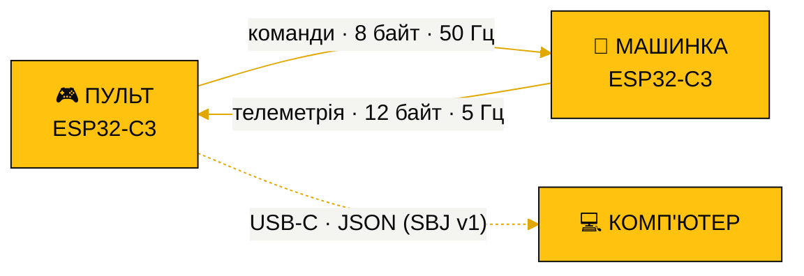

<p align="center"></p>

<h1 align="center"></h1>

<p align="center">
  <b>ROBOT&nbsp;FOR&nbsp;ROBOFOOTBALL</b><br>
  <sub>робот для робофутболу · ESP32-C3 · Bluetooth LE · 3D-друк</sub>
</p>

<p align="center">
<a href="https://www.espressif.com/en/products/socs/esp32-c3"></a>

<a href="https://www.arduino.cc/en/software"></a>

<a href="LICENSE"></a>
</p>

<p align="center">

</p>

<p align="center">
  <b>
    <a href="#про-проєкт">Про проєкт</a> ·
    <a href="#машинка">Машинка</a> ·
    <a href="#пульт">Пульт</a> ·
    <a href="#як-це-працює">Як це працює</a> ·
    <a href="#схеми-підключення">Схеми</a> ·
    <a href="#швидкий-старт">Швидкий старт</a> ·
    <a href="#3d-друк">3D-друк</a> ·
    <a href="#структура-репозиторію">Структура</a>
  </b>
</p>

<p align="center"></p>

## Про проєкт

**Soccer Bee** — це робот для робофутболу: компактна чотириколісна машинка з жовтим «ковшем» спереду й сердитим личком, і власний пульт-геймпад з екраном. Машинка і пульт говорять між собою по **Bluetooth LE**, обидва працюють на **ESP32-C3**. Корпуси надруковані на 3D-принтері, а креслення, прошивки та файли для друку лежать у цьому репозиторії.

<p align="center">
<br>
<sub><b>Машинка і пульт · фінальний рендер</b></sub>
</p>

<table>
<tr>
<th align="center" width="33%">🐝 МАШИНКА · V1.0</th>
<th align="center" width="33%">🎮 ПУЛЬТ · V1.1</th>
<th align="center" width="33%">🖨️ ДРУК</th>
</tr>
<tr valign="top">
<td>

- ESP32-C3 SuperMini
- 2× драйвер L298N, 4 мотори (по два на борт)
- живлення 2× 18650 (2S), Mini-360 дає 5 В для ESP
- failsafe: немає команд 300 мс — стоп
- телеметрія 5 разів на секунду

</td>
<td>

- ESP32-C3 SuperMini
- 2 стіки KY-023 і 2 кнопки
- OLED 128×64 з меню й дебагом
- MPU-6050: керування нахилом пульта
- акумулятор 18650, зарядка TP4056 через USB-C
- USB-контролер для ПК

</td>
<td>

- 15 жовтих + 5 чорних деталей машинки
- 4 деталі корпусу пульта
- готові проєкти 3MF
- CAD-моделі у форматі STEP

</td>
</tr>
</table>

<p align="center"></p>

## Машинка

Чорний корпус із жовтими деталями: «очі», «брови», «рот», світлові смуги, кутові захисти й ківш спереду. Усередині — двоповерхове шасі з акумулятором, двома драйверами L298N і платою ESP32-C3.

<table>
<tr>
<td align="center" width="50%"><br><sub><b>Спереду: личко і жовтий ківш</b></sub></td>
<td align="center" width="50%"><br><sub><b>Ззаду: вентиляція і порти</b></sub></td>
</tr>
<tr>
<td align="center" width="50%"><br><sub><b>Шасі: драйвери, плата, батарейний відсік</b></sub></td>
<td align="center" width="50%"><br><sub><b>Каркас наскрізь: що де стоїть</b></sub></td>
</tr>
</table>

<table>
<tr>
<td align="center" width="50%"><br><sub><b>Фінальний рендер на прозорому тлі</b></sub></td>
<td align="center" width="50%"><br><sub><b>Машинка і пульт</b></sub></td>
</tr>
</table>

### Розбірка машинки

<p align="center">
<br>
<sub><b>Розбірка машинки: від корпусу до шасі</b></sub>
</p>

### Колаж

<p align="center">
<br>
<sub><b>Колаж</b></sub>
</p>

<p align="center"></p>

## Пульт

Пульт у формі геймпада: два стіки, дві кнопки, OLED-екран, гіроскоп і бузер. Керувати можна стіками або **нахилом самого пульта** (MPU-6050). Екран показує заставку, стан зв'язку, батарею пульта й машинки, а також дебаг-картки для налаштування.

<p align="center">
<br>
<sub><b>Пульт · загальний вигляд</b></sub>
</p>

<table>
<tr>
<td align="center" width="50%"><br><sub><b>OLED, кнопки B1 / B2 і вимикач збоку</b></sub></td>
<td align="center" width="50%"><br><sub><b>Прозорий корпус: плата, MPU і акумулятор</b></sub></td>
</tr>
</table>

### Розбірка пульта

<p align="center">
<br>
<sub><b>Розбірка пульта</b></sub>
</p>

### План корпусу

<p align="center">
<br>
<sub><b>Розкладка компонентів у корпусі · габарит 150 × 109 × 30.5 мм</b></sub>
</p>

Кріплення тільки **M3 і M2 (DIN 912)**: 6× M3×20 і 6 гайок M3 на корпус, 8× M3×8 на стіки KY-023, 4× M2×4 на OLED, 2× M2×8 на тримач кнопок, 2× M2×6 на MPU і 3× M2×8 на планку ESP з зарядкою.

### Екран пульта

<p align="center">
  <br>
  <sub><b>Заставка пульта: личко моргає, мелодія грає рівно</b></sub>
</p>

<p align="center">
<br>
<sub><b>Заставка й основний екран: офлайн, підключення, їзда, режими</b></sub>
</p>

<p align="center">
<br>
<sub><b>Швидкість, калібрування, дебаг-картки</b></sub>
</p>

<p align="center">
<br>
<sub><b>Інфо-сторінки: підказки по керуванню</b></sub>
</p>

### Керування

| Дія | Що робить |
|---|---|
| Лівий стік Y | газ |
| Правий стік X | поворот |
| Клік стіка | газ переходить на цей стік |
| **B1** | меню: основне → дебаг → інфо |
| **B1** 3 с (дебаг, картка «Зв'язок») | забути машинку й шукати нову |
| **B2** | перемикання стіки / MPU |
| **B2** 2 с | калібрування центрів стіків і гіроскопа |
| обидва стіки (SW+SW) 1 с | екран швидкості (ліміти повороту й газу) |

<p align="center"></p>

## Як це працює



Пульт сам шукає машинку з іменем `SoccerBee-XXXX`, підключається й запам'ятовує її. Далі 50 разів на секунду шле короткий пакет керування, а машинка 5 разів на секунду відповідає телеметрією.

| Пакет | Напрям | Розмір | Частота | Що всередині |
|---|---|---|---|---|
| **Команда** | пульт → машинка | 8 байт | 50 / с | газ, поворот (−100…100), ліміти газу й повороту, прапорець «можна їхати», XOR-сума |
| **Телеметрія** | машинка → пульт | 12 байт | 5 / с | напруга акумулятора, %, прапорці розряду / failsafe, скільки команд дійшло, вихід на борти, версія прошивки |

**Захист:**

- немає пакетів **300 мс** — машинка зупиняється (failsafe);
- акумулятор ≤ **6.8 В** — «розряджений», ≤ **6.4 В** — «критичний»;
- пакети мають магічний байт і XOR-суму, биті відкидаються.

**USB-контролер (пульт V1.1).** Пульт, підключений кабелем USB-C до комп'ютера, віддає стіки, кнопки, нахил MPU-6050, батарею, зв'язок і телеметрію машинки JSON-рядками (протокол **SBJ v1**). Команди: `hello`, `stream on [Гц]`, `stream off`, `state`, `pc on|off`, `beep <Гц> <мс>`.


<p align="center"></p>

## Схеми підключення

Схеми показують, який пін до чого підключений і як влаштоване живлення. Натисніть на картинку, щоб відкрити її у повному розмірі.

### Машинка

<p align="center">
<a href="%D0%94%D0%BE%D0%BA%D1%83%D0%BC%D0%B5%D0%BD%D1%82%D0%B0%D1%86%D1%96%D1%8F/%D0%A1%D1%85%D0%B5%D0%BC%D0%B8/SoccerBee_Car_wiring.jpg"></a><br>
<sub><b>Машинка: ESP32-C3 SuperMini + 2× L298N · прошивка V1.0</b></sub>
</p>

- Перемички ENA / ENB і 5V-EN на обох драйверах L298N зняті.
- Резистори по 10 кОм з GPIO5 і GPIO10 на GND, щоб мотори не смикалися при старті.
- Mini-360 виставити на 5.0 В мультиметром **до** підключення ESP.
- GND акумулятора, обох L298N, Mini-360 і ESP — одна спільна точка.
- Мотор крутиться не туди: поміняти його дроти на OUT або `inv l` / `inv r`.

### Пульт

<p align="center">
<a href="%D0%94%D0%BE%D0%BA%D1%83%D0%BC%D0%B5%D0%BD%D1%82%D0%B0%D1%86%D1%96%D1%8F/%D0%A1%D1%85%D0%B5%D0%BC%D0%B8/SoccerBee_TX_wiring.jpg"></a><br>
<sub><b>Пульт TX v2: ESP32-C3 SuperMini</b></sub>
</p>

- Стіки, OLED і MPU-6050 живляться від **3.3 В**, а не від 5 В.
- Заряджати й прошивати при **вимкненому** вимикачі: ESP живиться від USB, а акумулятор заряджається окремо.
- **GPIO2 — strapping-пін**: на старті він має бути HIGH, тому «мінус» правого стіка підключений до GPIO21, а не до GND.
- LDO 3.3 В: AP7361C-33E, LDL1117S33, AP2112K або ME6211. **AMS1117 не підходить.**
- Бузер HC-12085 керується через NPN (S8050 / BC547) з GPIO10.

<p align="center"></p>

## Швидкий старт

**Arduino IDE**

- Плата: `Nologo ESP32C3 Super Mini` (або `ESP32C3 Dev Module` з **USB CDC On Boot: Enabled**).
- Ядро: **esp32 by Espressif 3.x** (перевірено на 3.3.12).
- Пульту потрібна бібліотека **U8g2** (Library Manager), машинці більше нічого.
- Кожна папка в `Прошивки/` — окремий скетч: відкривай `SoccerBee_TX.ino` і `SoccerBee_Car.ino`.
- Файл `sb_protocol.h` **однаковий в обох папках**. Змінюєш в одній — копіюй в іншу.

**Перший запуск**

1. **Машинка.** Проший, підніми так, щоб колеса крутились у повітрі. У Serial Monitor (115200, Newline) введи `m 60 0`: лівий борт має їхати вперед; `m 0 60` — правий.
   - Не туди їде борт: `inv l` або `inv r`.
   - Борти переплутані: `swap`.
   - Мотор гуде, але не рушає: `minpwm 90`.
   - Напруга не збігається з мультиметром: `cal 7.95` (значення з мультиметра).
   - Усе зберігається у флеш автоматично.
2. **Пульт.** Проший і відкалібруй стіки: утримай **B2 2 с**. Крок 1 — відпусти стіки й не рухай пульт (0.8 с). Крок 2 — покрути обидва стіки до упору по колу (5 с).
3. **Прив'язка.** Пульт сам знайде найближчу машинку й запам'ятає. Інша машинка: **B1** → дебаг, картка «Зв'язок», утримай **B1 3 с**.
4. **Бузер** за замовчуванням пасивний (тон). Якщо пищить тільки від `ba` в дебаг-скетчі, введи в пульті `buz a`.

**Режим MPU.** Нахил вперед їде назад — у `SoccerBee_TX.ino` постав `MPU_INV_THR = true`. Вбік навпаки — `MPU_INV_STEER = true`. Газ іде від бокового нахилу — `MPU_SWAP_AXES = true`.

<p align="center"></p>

## 3D-друк

Усі деталі лежать у `Друк_3D/`. Для кожної частини є окремі **STL** і готовий проєкт **3MF** («Друк всього»), у якому все розкладено на столі.

| Що | Файли | Де |
|---|---|---|
| Основні частини машинки (чорні) | 5 STL: корпус перед і зад, задня кришка, задній текст, кронштейн вимикача | `Друк_3D/Машинка/Чорні_деталі/` |
| Декор машинки (жовтий) | 15 STL: око, брова, рот, ківш, світлові смуги, бічні смуги, кутові захисти, номер на даху | `Друк_3D/Машинка/Жовті_деталі/` |
| Корпус пульта | верхня кришка, нижня частина, тримач кнопок, тримач кнопки B | `Друк_3D/Пульт/` |
| CAD | `Main part Car.step`, `Main part TX.step` | `CAD/` |

<p align="center"></p>

## Структура репозиторію

```text
Soccer-Bee/
├── CAD/                           STEP-моделі машинки й пульта
├── Документація/
│   ├── Анімації/                  GIF розбірки машинки й пульта
│   ├── Оформлення/                заголовок, бейджі й розділювач для README
│   ├── Пульт/                     фото, план корпусу, екрани пульта
│   ├── Рендери_і_скріншоти/       рендери та фото машинки
│   └── Схеми/                     схеми підключення машинки й пульта
├── Друк_3D/
│   ├── Машинка/
│   │   ├── Жовті_деталі/          STL декору + «Друк всього» (3MF)
│   │   └── Чорні_деталі/          STL корпусу + «Друк всього» (3MF)
│   └── Пульт/                     STL і 3MF корпусу пульта
├── Прошивки/
│   ├── SoccerBee_Car/             прошивка машинки V1.0
│   └── SoccerBee_TX/              прошивка пульта V1.1
├── LICENSE
└── README.md
```

<p align="center"></p>

<p align="center">
  <sub>Розроблено by <a href="https://github.com/Stanislav-developer">Stanislav developer</a> разом з C.C.C.</sub><br>
  <sub>Soccer Bee · Robot for Robofootball · ліцензія <a href="LICENSE">Apache 2.0</a></sub>
</p>
